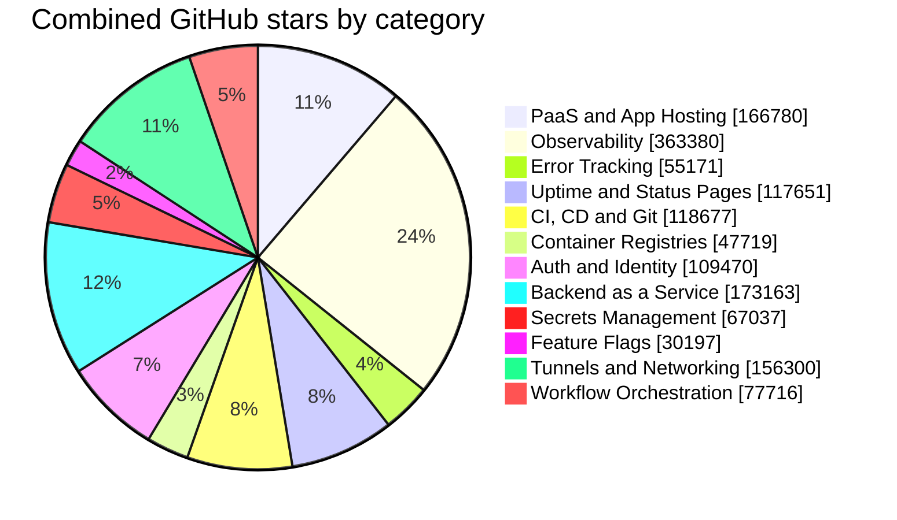

# Awesome Craft DevOps 

> A curated list of open-source, self-hostable alternatives to popular DevOps and hosting SaaS tools.

Paid PaaS, observability and CI bills add up fast. Every project here can be self-hosted, and each entry names the paid tool it replaces. Check each project's licence before you host or resell it for clients.

Related list: [Awesome Craft](https://github.com/EdisonTKPcom/Awesome-Craft), open-source alternatives to popular SaaS tools.

## Contents

- [Dashboard](#dashboard)
- [PaaS and App Hosting](#paas-and-app-hosting)
- [Observability](#observability)
- [Error Tracking](#error-tracking)
- [Uptime and Status Pages](#uptime-and-status-pages)
- [CI, CD and Git](#ci-cd-and-git)
- [Container Registries](#container-registries)
- [Auth and Identity](#auth-and-identity)
- [Backend as a Service](#backend-as-a-service)
- [Secrets Management](#secrets-management)
- [Feature Flags](#feature-flags)
- [Tunnels and Networking](#tunnels-and-networking)
- [Workflow Orchestration](#workflow-orchestration)

## Dashboard

<table>
<tr>
<td align="center"><h2>40</h2>open-source tools</td>
<td align="center"><h2>50</h2>SaaS products replaced</td>
<td align="center"><h2>1.48M</h2>combined GitHub stars</td>
<td align="center"><h2>193.7k</h2>combined forks</td>
<td align="center"><h2>40/40</h2>pushed in the last 30 days</td>
<td align="center"><h2>8</h2>languages</td>
</tr>
</table>

Stats snapshot taken on 2026-11-15 from the GitHub API. Star badges next to each entry update live.

### 🏆 Leaderboard

<table>
<tr><th>Rank</th><th>Project</th><th>Replaces</th><th align="right">Stars</th><th></th></tr>
<tr><td align="center">🥇</td><td><b>Supabase</b></td><td>Firebase</td><td align="right">115.1k</td><td><code>████████████████████</code></td></tr>
<tr><td align="center">🥈</td><td><b>frp</b></td><td>Cloudflare Tunnel, ngrok</td><td align="right">110.6k</td><td><code>███████████████████</code></td></tr>
<tr><td align="center">🥉</td><td><b>Uptime Kuma</b></td><td>Pingdom, UptimeRobot, Statuspage</td><td align="right">94.3k</td><td><code>████████████████</code></td></tr>
<tr><td align="center">4</td><td><b>Netdata</b></td><td>Datadog, New Relic</td><td align="right">81.4k</td><td><code>██████████████</code></td></tr>
<tr><td align="center">5</td><td><b>Grafana</b></td><td>Datadog, New Relic</td><td align="right">77.9k</td><td><code>██████████████</code></td></tr>
<tr><td align="center">6</td><td><b>Prometheus</b></td><td>Datadog, CloudWatch</td><td align="right">67.6k</td><td><code>████████████</code></td></tr>
<tr><td align="center">7</td><td><b>Coolify</b></td><td>Vercel, Netlify, Heroku, Railway</td><td align="right">66.1k</td><td><code>███████████</code></td></tr>
<tr><td align="center">8</td><td><b>Gitea</b></td><td>GitHub, GitLab</td><td align="right">59.1k</td><td><code>██████████</code></td></tr>
<tr><td align="center">9</td><td><b>Appwrite</b></td><td>Firebase</td><td align="right">58.1k</td><td><code>██████████</code></td></tr>
<tr><td align="center">10</td><td><b>Apache Airflow</b></td><td>Astronomer, Amazon MWAA</td><td align="right">47.5k</td><td><code>████████</code></td></tr>
</table>

### Stars by category

### Licences

     

"Custom" means GitHub couldn't match the licence to a standard one, often because of open-core or extra terms. Read it before you use the project commercially.

## PaaS and App Hosting

- [CapRover](https://github.com/caprover/caprover) - Heroku-style PaaS built on Docker, with one-click apps and SSL, an alternative to Heroku and DigitalOcean App Platform. 
- [Coolify](https://github.com/coollabsio/coolify) - PaaS for deploying apps, databases and services from a single dashboard, an alternative to Vercel, Netlify, Heroku and Railway. 
- [Dokku](https://github.com/dokku/dokku) - Small Docker-based PaaS that deploys from Git like Heroku, an alternative to Heroku. 
- [Dokploy](https://github.com/Dokploy/dokploy) - Docker-based PaaS with Compose, databases and preview deploys, an alternative to Vercel, Heroku and Railway. 
- [Kamal](https://github.com/basecamp/kamal) - Deploy web apps to your own servers with Docker and zero-downtime rollouts, an alternative to Heroku, Render and Railway. 

## Observability

- [ClickStack](https://github.com/ClickHouse/ClickStack) - Observability platform, formerly HyperDX, that unifies session replay, logs, metrics, traces and errors, an alternative to Datadog and New Relic. 
- [Grafana](https://github.com/grafana/grafana) - Dashboards and visualization for metrics, logs and traces, an alternative to Datadog and New Relic. 
- [Jaeger](https://github.com/jaegertracing/jaeger) - Distributed tracing for microservices, an alternative to Datadog and New Relic. 
- [Loki](https://github.com/grafana/loki) - Log aggregation designed to be cost-effective and easy to operate, an alternative to Datadog, Logtail and Loggly. 
- [Netdata](https://github.com/netdata/netdata) - Real-time infrastructure monitoring with per-second metrics, an alternative to Datadog and New Relic. 
- [OpenObserve](https://github.com/openobserve/openobserve) - Logs, metrics and traces with a focus on lower storage cost, an alternative to Datadog and Splunk. 
- [Prometheus](https://github.com/prometheus/prometheus) - Metrics collection and alerting, the standard for Kubernetes monitoring, an alternative to Datadog and CloudWatch. 
- [SigNoz](https://github.com/SigNoz/signoz) - APM, metrics, logs and traces in one OpenTelemetry-native platform, an alternative to Datadog and New Relic. 
- [VictoriaMetrics](https://github.com/VictoriaMetrics/VictoriaMetrics) - Fast, cost-efficient time series database and long-term Prometheus storage, an alternative to Datadog and Grafana Cloud. 

## Error Tracking

- [Highlight](https://github.com/highlight/highlight) - Error monitoring, session replay, logging and tracing in one platform, an alternative to Sentry, LogRocket and Datadog. 
- [Sentry](https://github.com/getsentry/sentry) - Error tracking and performance monitoring you can self-host. Recent versions use the Functional Source Licence, so read it before you use it commercially, an alternative to Sentry Cloud, Bugsnag and Rollbar. 

## Uptime and Status Pages

- [Gatus](https://github.com/TwiN/gatus) - Automated health checks and status pages, configured as code, an alternative to Pingdom and Statuspage. 
- [Healthchecks](https://github.com/healthchecks/healthchecks) - Cron job and heartbeat monitoring, with alerts when jobs fail to check in, an alternative to Cronitor and Dead Man's Snitch. 
- [Uptime Kuma](https://github.com/louislam/uptime-kuma) - Self-hosted monitoring with a polished UI, alerts and status pages, an alternative to Pingdom, UptimeRobot and Statuspage. 

## CI, CD and Git

- [Argo CD](https://github.com/argoproj/argo-cd) - GitOps continuous delivery for Kubernetes, an alternative to GitHub Actions and Harness. 
- [Gitea](https://github.com/go-gitea/gitea) - Lightweight forge for Git hosting, issues, pull requests and packages, an alternative to GitHub and GitLab. 
- [Jenkins](https://github.com/jenkinsci/jenkins) - Extensible automation server for building and deploying projects, an alternative to GitHub Actions and CircleCI. 
- [Woodpecker CI](https://github.com/woodpecker-ci/woodpecker) - Lightweight CI engine that runs pipelines in containers, a community fork of Drone, an alternative to GitHub Actions and CircleCI. 

## Container Registries

- [Harbor](https://github.com/goharbor/harbor) - Container registry with vulnerability scanning, replication and access control, an alternative to Docker Hub and Amazon ECR. 
- [Verdaccio](https://github.com/verdaccio/verdaccio) - Lightweight private npm registry and proxy, an alternative to npm and GitHub Packages. 

## Auth and Identity

- [Authelia](https://github.com/authelia/authelia) - Authentication portal for self-hosted apps, with SSO and two-factor auth, an alternative to Cloudflare Access and Auth0. 
- [Authentik](https://github.com/goauthentik/authentik) - Flexible identity provider with SSO, MFA and application proxying, an alternative to Auth0 and Okta. 
- [Keycloak](https://github.com/keycloak/keycloak) - Identity and access management with SSO, social login and user federation, an alternative to Auth0, Okta and Cognito. 
- [Zitadel](https://github.com/zitadel/zitadel) - Cloud-native identity platform with a built-in management console, an alternative to Auth0 and Cognito. 

## Backend as a Service

- [Appwrite](https://github.com/appwrite/appwrite) - Backend platform with auth, databases, storage and serverless functions, an alternative to Firebase. 
- [Supabase](https://github.com/supabase/supabase) - Postgres-based backend with auth, APIs, storage and realtime, an alternative to Firebase. 

## Secrets Management

- [Infisical](https://github.com/Infisical/infisical) - Secret management for developers, with versioning and per-environment sync, an alternative to Doppler and HashiCorp Vault. 
- [Vault](https://github.com/hashicorp/vault) - Secrets, encryption and identity-based access. Later versions use a Business Source licence, so read it before you use it commercially, an alternative to Doppler and AWS Secrets Manager. 

## Feature Flags

- [Flagsmith](https://github.com/Flagsmith/flagsmith) - Feature flags and remote config, with a friendly admin UI, an alternative to LaunchDarkly. 
- [GrowthBook](https://github.com/growthbook/growthbook) - Feature flags and A/B testing, with a stats engine for experiments, an alternative to LaunchDarkly and Optimizely. 
- [Unleash](https://github.com/Unleash/unleash) - Feature-flag and experimentation platform, an alternative to LaunchDarkly. 

## Tunnels and Networking

- [frp](https://github.com/fatedier/frp) - Fast reverse proxy that exposes services behind NAT or firewalls, an alternative to Cloudflare Tunnel and ngrok. 
- [Headscale](https://github.com/juanfont/headscale) - Self-hosted control server for Tailscale networks, an alternative to Tailscale and Cloudflare Zero Trust. 

## Workflow Orchestration

- [Apache Airflow](https://github.com/apache/airflow) - Platform to author, schedule and monitor data pipelines as DAGs, an alternative to Astronomer and Amazon MWAA. 
- [Kestra](https://github.com/kestra-io/kestra) - Orchestration for scheduled and event-driven workflows, defined in YAML, an alternative to Prefect and Airflow Cloud. 

## Contributing

Contributions welcome! Read the [contribution guidelines](contributing.md) first.

If this list saved you a subscription, give it a ⭐ so others can find it.

